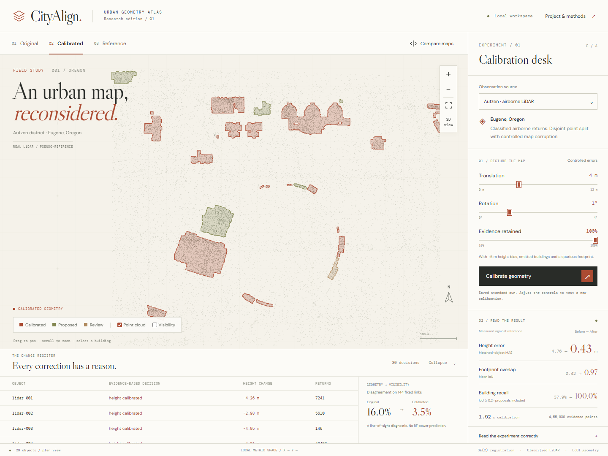
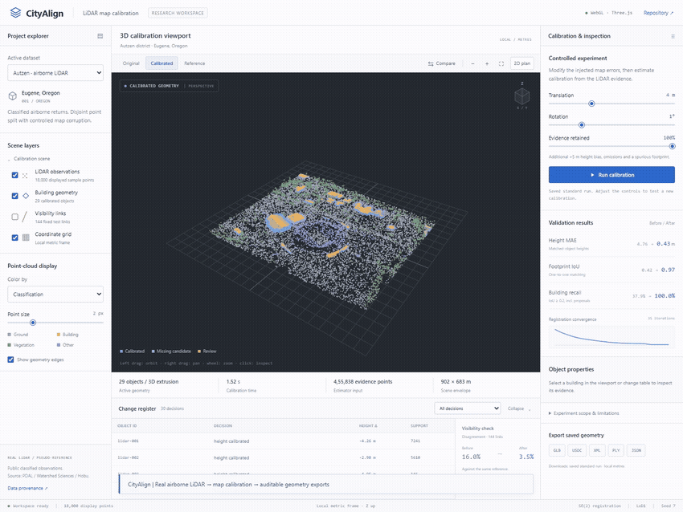
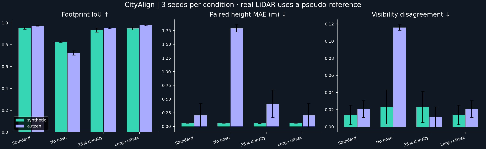
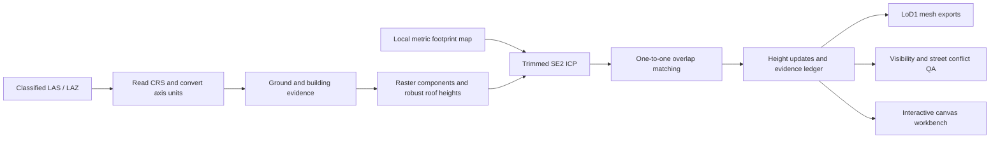

# CityAlign

**LiDAR evidence for urban map calibration.** A working Python + JavaScript research prototype for aligning stale 2.5D city maps, correcting building heights, finding missing footprints, and auditing changes before exporting 3D geometry.



**[Watch the screen demonstration (MP4)](results/demo.mp4)** · [Research foundations](docs/research.md) · [Measured experiments](results/benchmark.csv) · [Project / résumé brief](docs/PROJECT_BRIEF.md)



## Why this project

Urban geometry errors change whether a radio link intersects a building. CityAlign makes the geometry correction process inspectable: point evidence, estimated registration, per-building decisions, before/after measurements, a visibility diagnostic, and loadable mesh outputs. The work is motivated by the Ericsson Research thesis description on automated LiDAR-based map calibration. It uses public data and has no affiliation with Ericsson or access to its internal solutions.

This is a **geometric baseline with an interactive interface**, with a measured subsecond synthetic run and second-scale real-data calibration on the development machine. It is not a streaming sensor system or a guaranteed real-time service.

## Run locally

Python 3.11+ is required. Commands run from the repository root.

```powershell
python -m venv .venv
.venv\Scripts\Activate.ps1
python -m pip install -e ".[dev]"
python -m urban_calibrator.cli serve --port 8846
```

Open **http://127.0.0.1:8846**. Saved synthetic and real-data experiments are included, so the initial viewer needs no download. The interface supports before/after/reference views, 3D extrusions, point evidence, building inspection, pan/zoom, visibility links, and parameter-driven computation. Live reruns are temporary; download buttons explicitly refer to the saved standard experiments.

The cartographic interface puts the map first, with a calibration desk on the right, a collapsible evidence register, and a draggable before/after comparison. Warm paper, terracotta geometry and serif type distinguish the atlas from a conventional KPI dashboard. See [interface references and interaction design](docs/interface-design.md).

To compute the experiments yourself:

```powershell
python -m urban_calibrator.cli demo --scenario synthetic
python -m urban_calibrator.cli download
python -m urban_calibrator.cli demo --scenario autzen
python -m scripts.benchmark
python -m scripts.scale
python -m pytest -q
python -m scripts.validate_artifacts
```

The first real-data run downloads a checksum-verified **74.4 MB LAZ**. `usd-core` enables binary USDC. Optional `python -m pip install mitsuba` enables Mitsuba scene-load validation; scalar mode is sufficient. The static viewer has no JavaScript framework or CDN dependency; optional web fonts fall back to local system fonts offline. The server binds to localhost.

## Measured results

All values below come from committed JSON/CSV artifacts, not target values. The real scene is a **900 × 760 m crop of Autzen, Eugene, Oregon**, from an acquisition containing 10,653,336 points. The standard seed-7 estimator receives **455,838 held-out returns**. The pseudo-reference contains 29 extracted objects; the held-out extraction contains 27, reflecting sampling/topology differences.

| Seed-7 condition | Before | After |
| --- | ---: | ---: |
| Synthetic matched height MAE | 5.007 m | 0.061 m |
| Synthetic mean footprint IoU | 0.805 | 0.939 |
| Real-LiDAR matched height MAE | 4.760 m | 0.433 m |
| Real-LiDAR mean footprint IoU | 0.418 | 0.969 |
| Real-LiDAR building recall at IoU ≥ 0.2 | 37.9% | 100.0% |
| Real-LiDAR visibility disagreement, 144 links | 16.0% | 3.5% |

**Read the protocol:** synthetic truth is independent procedural geometry. For real data, one random half of the classified returns creates a pseudo-reference map. That map is corrupted with known translation, yaw, height bias, omissions, and a spurious footprint. The other half drives the estimator. Both halves share the same acquisition, manual labels, and extraction method. These results measure recovery from injected errors, **not accuracy against an independently surveyed or historical map**. Supplied building labels are not learned predictions. Matched-height MAE compares different matched sets before and after; use the paired metric below for a consistent cohort. Candidate footprints remain proposals even when evaluation counts them as matches.

### Ablations and robustness

**24 runs**: two datasets × three seeds (7, 11, 23) × four conditions. Mean results on real observations:

| Condition | Footprint IoU | Paired existing-object height MAE | Calibration time |
| --- | ---: | ---: | ---: |
| Standard | 0.973 | 0.205 m | 1.54 s |
| Alignment disabled | 0.725 | 1.791 m | 2.00 s |
| 25% evidence retained | 0.955 | 0.412 m | 1.21 s |
| 12 m x-offset / 3° yaw | 0.978 | 0.205 m | 2.00 s |

The y-offset equals −0.7 × x-offset. Timing covers extraction, registration and map decisions; it excludes download, preparation, visibility evaluation, and exports. See [environment](results/environment.json), [all runs including statuses](results/benchmark.json), and [mean/std/min/max](results/benchmark_summary.json). Three seeds share the same geography; their variation is not a multi-city generalization estimate. Registration is locally convergent, and performance outside these tested conditions is unestablished.



### Spatial scaling experiment

The overlapping-tile extractor recovered **256 / 256 procedural buildings from 845,312 points over a 1.44 km² envelope in 7.66 s**. [Raw scaling report](results/scaling.json). This repeats synthetic blocks and tests bounded-raster extraction, not complete city calibration or diverse real geography. Input point arrays stay in memory. Tile centroid ownership suppresses duplicates; structures exceeding the halo are skipped and recorded. Full city deployment still needs out-of-core indexing, registration consistency, boundary reconciliation and independent validation.

## How it works



1. **Ingest:** LAS/LAZ through laspy/lazrs, read compound CRS, convert each axis to metres, subtract a documented local origin. Autzen's header uses international feet horizontally and US survey feet vertically; conversion uses the actual header, not an assumed common factor.
2. **Extract evidence:** class-6 occupancy raster, morphological closing, connected components, polygon union/simplification, minimum area and support filters. Building height is the 75th percentile of roof returns above median nearby class-2 ground; sloped terrain and sparse ground remain failure modes.
3. **Align:** sample footprint boundaries, build a SciPy KD-tree, reject the largest 25% of correspondence distances, and iteratively solve a planar rigid transform with SVD. This is a custom trimmed point-to-point **SE(2)** ICP, not SE(3), Open3D point-to-plane ICP, or a TEASER++ implementation.
4. **Associate:** Hungarian one-to-one matching on polygon IoU, with a 0.2 acceptance threshold. Preserve existing footprints after pose correction rather than replacing cadastral boundaries with raster outlines. Use evidence-derived heights for matches.
5. **Audit:** unmatched observed buildings become candidates. An unmatched map object is removed from the proposal only if its footprint has at least 15 ground returns and fewer than three building returns. Otherwise it stays marked for review. These are heuristic evidence gates, not demolition certification. Confidence is an overlap/support heuristic, not a calibrated probability.
6. **Evaluate and export:** compare with the reference, retain a decision ledger, sample 144 transmitter/receiver links, and write LoD1 meshes. Classification counts for bridge/overhead structures trigger review; these structures are not flattened into asserted building corrections.

## Use your own map and cloud

The calibration input contract is intentionally explicit: a local metric NPZ containing `points` (finite N×3 XYZ) and `classes` (N ASPRS-style labels with 2=ground and 6=building); a Polygon FeatureCollection with `height` and optional `base` properties. Both must already use the same local projected coordinates and vertical datum. Geographic longitude/latitude input is unsupported. No arbitrary file uploads are exposed in the web server.

```powershell
python -m urban_calibrator.cli calibrate --points cloud.npz --map footprints.geojson --output results/custom
python -m urban_calibrator.cli calibrate --points cloud.npz --map footprints.geojson --streets centerlines.geojson --output results/custom
python -m urban_calibrator.cli extract-tiles --points cloud.npz --tile-size 300 --halo 80 --output results/tiles
```

Optional street GeoJSON must contain metric LineString/MultiLineString centerlines. QA buffers a 3 m half-width corridor and reports building intersections, ground and roof support. It **does not reconstruct or move streets**, infer street semantics from ground, or resolve grade-separated bridges. Tiled extraction outputs observed candidates separately; it is not a replacement for a globally consistent city map optimizer.

## Outputs and interoperability

| Artifact | Convention and validation |
| --- | --- |
| `calibrated.geojson` | Local metric Polygon features, heights/base, support and decision; not RFC 7946 longitude/latitude GeoJSON |
| `calibrated.glb` | glTF 2.0 binary; metres, +Y up; `(east, north, up) → (east, up, −north)`; loaded back with trimesh |
| `calibrated.usdc` | Genuine binary USD Crate, Z up, metres; magic bytes and OpenUSD load checked |
| `calibrated.ply` + `scene.xml` | Z-up LoD1 mesh, Mitsuba 3 scene; loaded with Mitsuba `scalar_rgb` |
| `report.json` | Registration, timing, matches, changes, geometry metrics, visibility and complexity review |
| `viewer.json` | Saved view state plus a seeded sample of up to 18,000 points |
| `provenance.json` | Source URL/hash, CRS, axis factors, crop, sampling and corruption parameters |

Download [real-data GLB](results/autzen/calibrated.glb), [USDC](results/autzen/calibrated.usdc), [scene XML](results/autzen/scene.xml), [PLY](results/autzen/calibrated.ply), and [report](results/autzen/report.json). Keep XML and PLY together. [Artifact validation record](results/artifact_validation.json).

The Mitsuba material is optical diffuse. **Sionna radio materials and path solving are not integrated or validated.** The LoS diagnostic computes segment/prism intersections; it predicts no received power, reflections, diffraction, scattering, antenna effects, or network-performance improvement.

## Validation and engineering decisions

The ten-test suite checks known-transform recovery, height-error recovery, retention of unobserved map geometry, true intersection-height visibility, missing-ground rejection, courtyard roof area and axis conversion, concave-mesh closure and outward winding, API parameter validation, tile-seam ownership, and street conflict flags. Constrained triangulation preserves concave roof and courtyard boundaries. Export validation separately reloads actual committed artifacts and verifies watertightness and consistent winding after merging coincident vertices. Browser validation exercises saved data, stage controls, building inspection, 3D, visibility links, a live reduced-density calculation, dataset switching and responsive layout. [Browser record](results/browser_validation.json).

There is no training phase or GPU requirement. A deterministic geometric baseline keeps data assumptions and failure causes inspectable before adding a learned model. Relevant learned reconstruction and robust-global-registration extensions are discussed in the [primary-source research review](docs/research.md).

## Alignment with the thesis role

| Requirement | Evidence in this repository |
| --- | --- |
| Python plus another language | Python pipeline/API; JavaScript canvas interface and browser workflow |
| LiDAR / point clouds / geospatial data | Real classified LAZ, chunked source reading, compound CRS and explicit metric conversion |
| Registration and building-map differences | SE(2) ICP, height calibration, missing candidates, unsupported-object evidence gates |
| 2.5D / 3D map formats | Loadable GLB, binary USDC, Mitsuba XML/PLY |
| Experimental design | Seeded corruption, disjoint real-point split, paired metrics, 24 ablation runs, density/pose stress |
| Radio-propagation relevance | Visibility sensitivity diagnostic with a clear boundary to full RF simulation |
| Complex structures / streets | Classified complexity review; optional street-corridor conflict audit; reconstruction remains future work |
| City-scale research direction | Bounded overlapping-tile extraction, measured spatial stress test; complete city validation remains open |
| Reproducible software and communication | CLI, tests, environment record, provenance, ledger, screenshots, demonstration, technical brief |

## Known limitations and next experiments

Airborne returns and class labels can miss structures. Raster closing can join adjacent roofs or split sparse components; the reference extraction itself changes across point splits. A single height cannot represent complex roofs, courtyards with vertical variation, bridges or overhangs. Nearby-ground normalization can bias heights under slope or distant ground. ICP can align repeated structures incorrectly, especially outside its local basin. The missing-building threshold is permissive; the precision/recall figures depend on it. The visibility grid is a sensitivity demonstration, not an RF validation dataset.

The next defensible experiments are an independently dated footprint map paired with AHN/3DEP, manually audited roof/height targets, class-label noise and occlusion stress tests, a larger range of initial poses, global-registration baselines, LoD2 reconstruction through City3D/roofer, consistent multi-tile optimization, and Sionna validation with explicit radio materials. Do not claim these as implemented.

## Data and code licensing

Code: [MIT](LICENSE). Public observations and their derived Autzen geometry/visualizations: [CC BY 4.0](https://github.com/PDAL/data/blob/main/LICENSE). Attribution: **Watershed Sciences / Aaron Reyna, 2010; Hobu / Max Sampson, classifications 2021; PDAL/data**. Changes include a local crop, deterministic sampling, per-axis coordinate conversion, geometric extraction, intentionally corrupted maps, calibrated proposals and visualization. The original LAZ is downloaded on demand and excluded from Git. See [data notice](data/README.md) and [third-party notice](THIRD_PARTY_NOTICES.md).
